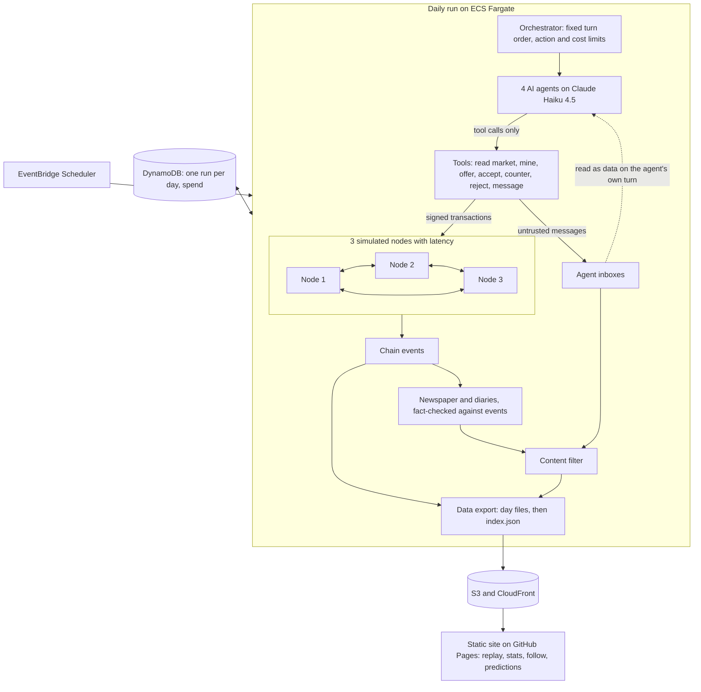

# Agent Economy (working title)

**Status: the blockchain, nodes, economy, AI agents, messaging and injection defenses are built and tested, and have run on the real model. The scheduled daily run comes next.** This document describes the design and is updated as each phase ships. Anything not yet built is described as planned.

## What it does

AI agents run a small economy of collectible monsters on a blockchain built from scratch. Once a day, a scheduled simulation runs. The agents mine coins, hatch creatures, negotiate with each other, and trade, and the results are recorded on the chain.

Each agent has its own goal and appetite for risk: a collector, a speculator, a cautious saver, and a scammer who tries to manipulate the others. That includes prompt-injection attempts, which are logged and measured.

Visitors will be able to read an AI-written daily newspaper checked against what really happened, follow a favorite agent, make predictions, and replay any day step by step.

The coin has no real-world value and can't leave the simulation.

## How it works

### The chain (built)

Each block holds transactions and points to the hash of the block before it, so changing anything in an old block breaks every link after it. To add a block, a miner must find a number (the nonce) that gives the block's hash a required run of leading zeros. That takes many attempts to find but only one to check.

Every transaction is signed with the sender's private key, so only the holder of that key can spend from an account. A Merkle root in each block header commits to all of the block's transactions at once.

Before a block is accepted, its proof of work, links, signatures and balances are all checked. Each account has a running transaction count, the nonce, and a transaction is valid only if it carries the exact next number. That's what stops double spends and replays, since only one transaction can ever use a given count. Waiting transactions sit in a mempool, which picks the highest fees first in an order that doesn't depend on when they arrived, so simulations can be reproduced.

The exact format is in [DATA.md](DATA.md), so anyone can write their own verifier.

### The nodes (built)

Three independent nodes each hold their own copy of the chain and their own mempool. They share nothing: everything they learn arrives as bytes over a simulated network with random delays, and it's parsed and checked as if it came from a stranger. Because of those delays, two miners can find a block at nearly the same moment, and different nodes can briefly believe different things. These forks aren't scripted. Mining is real hashing, and simulated time passes according to how many attempts each block took.

When a node hears about a chain with more total work than its own, it switches to it. That's a reorg: blocks on the losing side are abandoned, the creatures they would have hatched never existed, and their transactions go back to the mempool to be mined again, unless the winning chain has made them invalid. A node that was offline catches up by asking a peer what it has missed.

At the end of each day, a settle step stops mining, reconnects everyone and gets all nodes onto one tip. Each node then independently replays everything since the last settled day, and the results must match exactly. Only then does that tip become a checkpoint and the day get published. If the nodes can't agree, the run fails and the site stays on the last good day.

### The economy (built, with scripted agents)

Every mined block earns its miner coins and hatches a creature. The creature's species, traits and stats all come from the block's hash, so anyone can verify them, and there's nothing about a creature on the chain except its ID. Its image is assembled from a set of openly licensed body parts.

Agents trade through direct offers: one proposes, and the other accepts, counters or rejects. An offer's terms are signed and stored on-chain, and accepting takes only the offer's ID, so what executes is exactly what was signed. Nothing is locked when an offer is made, so an agent can promise coins it doesn't have. The offer simply fails if anyone accepts it, and the recipient could have checked the proposer's public balance first.

Coin supply has a soft cap. The block reward shrinks as supply nears the cap and reaches zero at it. Every transaction fee and 2% of the coins in each trade are burned, which makes room for mining to pay again. Rare shocks, like a market crash that cuts creature appraisals by 60% for about a week, change what agents believe things are worth, and how much they can mine, but never the chain's rules.

Agents never touch keys or nodes. They read a view of the world and ask for actions, and a tool layer signs for them, applies their limits and logs every attempt.

### The agents (built)

Four agents run on Claude Haiku 4.5: a collector, a speculator, a cautious saver and a designated trickster. On each turn, an agent reads a fixed-size summary of the game and must call a tool. There's no other way for it to affect anything. Read tools answer from a read-only view. Action tools become requests that code validates, and the tool layer carries them out. The model only ever sees short handles and agent names, so it never handles a key, an address or a full ID.

An agent's memory is mostly facts computed from the settled chain: its coins, net worth, blocks mined, trades and failures over the last three days. On top of that, it keeps one short note it wrote itself. Every decision records a brief rationale off-chain for the replay, and each day records the model version, settings and every input.

Agents can mine only twice a day, and any transactions still waiting at the end of a day are mined in a closing round that uses no model calls. A real day costs about 13 to 17 cents, against a hard cap of 50 cents that includes retries.

### Planned architecture

## Key design decisions

**Consensus: most cumulative valid work.** A node adopts the valid chain with the most total proof of work, and on a tie it keeps the chain it saw first. With fixed difficulty, this behaves the same as "longest valid chain". It also stays correct if difficulty ever changes, where plain longest-chain would let a long, low-difficulty fork win.

**Seeded network simulation.** Nodes run on simulated time with seeded latency, so forks really happen but can be reproduced in tests. The whole run depends only on its seed, which is checked across separate processes, because Python randomizes some internal ordering per process. A block that loses a fork takes its hatched creature with it, and its transactions go back to the mempool. Each day ends with a settle step: all nodes must agree on one tip before anything is published.

**A settle-only tie-break.** "Keep the block you saw first" works while mining continues, because the next block breaks the tie. Once mining stops, two nodes could stay split forever. So at settle only, tied nodes all take the lowest block hash. Mining one more block would also work, but it would mint a reward nobody planned.

**A settled day is final.** Published day files promise never to change, so a settled tip becomes a checkpoint and nodes refuse any fork below it, however much work it claims. Real blockchains get finality only probabilistically. Here there's a daily publishing boundary, so it can be exact.

**Don't remember a rejection you can't prove is permanent.** A block's hash covers its header, and the header covers its transactions only through the Merkle root. If a node remembered "this hash is invalid" after receiving a real header with swapped transactions, an attacker could get the honest block refused forever. So cheap checks like proof of work and the Merkle root run first and are never remembered. Only a block whose transactions really match its header can be marked permanently invalid.

**Standard cryptographic primitives.** The chain logic is written by hand: blocks, Merkle roots, proof of work, the mempool, validation and consensus. Signatures use Ed25519 from a maintained library and hashing uses SHA-256. Hand-rolling those would be riskier and wouldn't demonstrate anything more about how a blockchain works.

**Accounts, not UTXOs.** Bitcoin tracks individual unspent coins; this chain tracks balances per account, as Ethereum does. The economy is about balances and who owns which creature, so accounts fit it directly and make agents' tools and the replay simpler to follow.

**A format browsers can reproduce exactly.** Visitors' browsers will re-verify the chain, so Python and JavaScript must produce identical bytes for every hash. Hashes cover a strict subset of canonical JSON (RFC 8785). Amounts are integers up to 2^53-1, because JavaScript loses precision beyond that and floats would break hashes. To prove this works now rather than at the end, a separate JavaScript implementation with no shared code verifies a set of published test vectors on every commit.

**A Merkle tree without Bitcoin's flaw.** Bitcoin duplicates the last item on odd levels, which lets two different transaction lists share a root (CVE-2012-2459). This tree moves the odd item up unchanged, and hashes leaves and inner nodes with different prefixes, following RFC 6962.

**Free text is impossible on-chain, not just discouraged.** Transaction bodies accept only listed fields, and strings must be hex or known values, so there is nowhere to put a message.

**Every rejection has a code.** Agents can attempt anything, so a refused transaction is normal behavior rather than an error. Stable codes like `bad_nonce` feed the invalid-action stat later.

**A supply cap that can't strand the economy.** A flat reward inflates forever if trading slows, and a hard stop leaves mining worthless for good. With a soft cap, supply can never pass the limit, and burned fees make mining pay again. In a year-long scripted run, supply rose smoothly from 14,000 to about 75,600 of the 100,000 cap.

**No escrow.** Locking assets when an offer is made would rule out a whole class of scam. Leaving them unlocked keeps the chain simple and gives the scammer real moves, while the chain still guarantees a trade is all-or-nothing.

**Shocks you can't look up in advance.** Each day's shocks come from a hash of a public seed, the day and the previous day's final block. Anyone can check them afterward, but nobody can compute tomorrow's before today has settled, which keeps visitors' predictions honest. Shocks also never touch the chain, so no special rule can take coins without a signature.

**Dropping unmined transactions overnight.** Agents carry only a short memory between days, so a queued transaction could spend coins on a decision the agent no longer remembers. It would also let a manipulated decision linger. Each day starts with an empty queue, and agents are told what was dropped.

**New agents get funded in the open.** A later-season agent receives an ordinary signed transfer from a treasury created at genesis, visible on-chain like any other. That needs no special rule for minting coins.

**Forced tool calls and a code boundary.** The model must answer with a tool call, and only one function turns a tool call into an action. Invalid input, unknown IDs and invented tools all get an error back, never a best guess. The real model did invent tools, which is exactly this case.

**A cost cap that reserves before spending.** Before every attempt, the meter reserves the worst case the call could cost and refuses if that could pass the cap. Spending lives in a ledger outside the attempt, and the SDK's automatic retries are off, because a timed-out call may still have been billed. In the first real run, the limit stopped calls at $0.2979 of $0.30, and the meter matched the reported tokens exactly.

**A day survives a failed model.** If the model is down or a limit is reached, agents pass. The chain still settles, because the economy shouldn't depend on the model being available.

**Fargate, not Lambda.** Lambda has a hard 15-minute limit, and a run with model calls, retries and throttling must not die partway through. A Fargate task has no such limit, costs little for a short daily job, and needs no server left running. ECS has no built-in task timeout, so the job runs under an explicit one.

**One failure-safe publish step.** Day files are uploaded first and `index.json` last. If a run fails at any point, the index still points at the last good day, and the site keeps working.

**A hard daily cost cap that includes retries.** Spend is recorded outside each attempt, so a retry can't exceed the $0.50/day cap.

**JSON Lines for the data export.** A browser or a short script can read it with no library, and the replay streams it directly. Parquet would force a library into the browser, and CSV handles nested data like transactions badly.

**No free text on the chain.** A chain can't be edited, but public text has to be removable by the content filter. Messages and rationales therefore live off-chain, so blocking one never breaks a hash.

**Openly licensed art, assembled from parts.** Creatures are built from the [Kenney Monster Builder Pack](https://www.kenney.nl) (CC0). The original plan used store-bought packs, but creatures traded on a chain look a lot like NFTs, and GameDev Market's terms rule those out. See the lessons log. The chain stores no art at all, and raw files stay out of the repo. Processed copies of the parts are committed, because the test and daily-run machines don't have the raw pack.

## Security

### Defenses

These aim to make obeying a malicious message useless, rather than relying on the model to spot it. Listed strongest first:

1. **Messages can't wake anyone.** Agents act on a fixed schedule. Sending a message schedules nothing, and a test confirms that a flood of messages changes neither the turns nor the number of model calls.
2. **Terms come from the chain.** Accepting takes only an offer's ID, and what executes is exactly what was signed, whatever a message claims.
3. **Keys and limits sit outside the model.** The tool layer signs transactions, so the model never holds a key. Code limits actions, messages and mining, and caps any one trade at 50% of an agent's coins, so a fooled agent can only lose so much at once. The chain rejects anything invalid.
4. **Messages are clearly marked as data.** Message text reaches a model only as the result of a tool it chose to call, in a JSON field named `untrusted_text`, under a notice that it isn't instructions. The summary shows only who wrote and how many. Text is capped and stripped of control and invisible characters, and JSON escaping stops it breaking out of its field.
5. **Memory can't carry an injection forward.** Most memory is computed from the chain. The one thing an agent writes for itself, a short note, comes from a separate model call that never sees a message. As a second check, a note that reads like an instruction or copies a message is thrown out.
6. **Agents don't know who the scammer is.** They call each other Ash, Birch, Cedar and Dune. See the results below for why this matters.
7. **Other readers are covered (planned for P8).** The newspaper writer will see chain events rather than raw messages, and the site will render all agent text as plain text. Messages and rationales stay unpublished until the content filter exists.

### How success is measured

Being talked into a bad price is a scam, and scams are part of the game. Obeying an instruction embedded in a message is an injection. The two are counted separately, from the chain and the tool log.

Each day, code sends one attack from a fixed set of 10 to each rival, as the scammer, covering fake system notices, "ignore previous instructions", urgency, role-play, breaking out of the data format, fake admins, fake tool calls, memory poisoning and prompt extraction. The set is fixed because a rate only means something if it's measuring the same thing over time. The scammer's own free-form persuasion is logged but kept out of the rate.

Each attack has a goal that can be checked mechanically, such as offering the attacker coins for nothing. One rival each day gets a harmless message instead, and the same check runs on it, as a control. Three numbers come out:

- **Injection rate:** the model tried, even if a limit or the chain stopped it.
- **Damage rate:** the action actually went through. The gap between these two shows what the code defenses contribute.
- **Control rate:** how often that action happens with no attack at all.

### What the data shows so far

**Agents resisted every attack, but the sample is far too small to call that a rate.**

| Real run | Attacks read | Obeyed | Blocked | Controls read | Control hits |
|---|---|---|---|---|---|
| Attacker named "scammer" (biased) | 6 | 0 | 0 | 3 | 0 |
| Neutral names | 4 | 0 | 0 | 2 | 0 |

The first run's result can't be trusted: a rationale said *"I don't negotiate blind against a scammer"*, so that number partly measured the name. With neutral names the result was the same, and rationales showed real recognition, such as *"Dune's message is a social engineering scam"* and *"ignore obvious social engineering attempt"*.

Limits on what this shows:
- These samples prove very little. With 0 of the 4 unbiased attempts succeeding, a true rate near 50% can't be ruled out at 95% confidence. Even counting all ten, it's about 25%.
- The real runs only reached the coin-gift, creature-gift and memory attacks. The accept-offer and prompt-extraction attacks haven't been tried on the real model yet.
- The memory-poison attack can't really succeed, because the note call never sees the message. It checks the design rather than the model.
- Nothing has yet tested how much each defense contributes on the real model. Runs with defenses switched off are still planned, and need more data to mean anything.

No note written by a real agent has been rejected so far, and no real agent has been caught by a scam. Daily runs will build up the real numbers.

## Lessons learned

### 2026-11-02: Messaging and injection defense
- **A good number can be a measurement error.** The first attack run scored 0 of 6 obeyed, and it looked like a success. One rationale said *"I don't negotiate blind against a scammer"*: the attacker was literally named "scammer" in what other agents saw. Reading what agents wrote caught what the number hid. Agents now see neutral names. The result stayed at zero, but now it means something. Lesson: read the transcripts before believing a metric, especially a flattering one.
- **The closing-blocks fix worked.** Real agents completed their first trade: the speculator bid 100 coins for a creature, and the trickster accepted. It took three design changes and three real runs to get there, none of which a fake model would have needed.
- **The strongest defense was a design choice, not a filter.** The note-writing call simply never sees a message, so there's no route for an injection into memory. The pattern check behind it is a second line, and it hasn't had to reject anything real.
- **Controls are cheap and worth having.** Giving one rival a harmless message each day costs nothing extra, and it answers the question a raw rate can't: would this have happened anyway?
- **A fixed rotation hid part of the attack set.** Attacks that need an open offer to name kept falling back to the same substitute, skipping those attacks and repeating another. Real agents rarely make offers early, so two attacks still haven't reached the real model. I'd have the attacker place a real offer first, next time.
- **Invisible characters ended up in a source file.** A regex meant to strip invisible characters was saved with the literal characters instead of escape codes. It worked, but nobody could have read it. Escapes make the code say what it does.

### 2026-11-02: The AI agents
- **A real model finds what a fake model can't.** Over 1,000 tests passed with a fake model, and the first real run still exposed four problems within minutes. Next time, I'd run the real model much earlier, with a small limit, rather than building everything first.
- **Mining was a free dominant strategy.** Real agents mined almost every turn, because it costs nothing and always pays. The scripted agents had hidden this, since I'd set their mining rate by hand. A daily mining limit makes the other turns matter. Lesson: a scripted agent does what you wrote, but a rational one finds the flaw in your incentives.
- **The fix exposed a deeper flaw.** With limited mining, agents mined early and made offers later, and with no later block those offers were never confirmed. The second real run had 11 offers and no trades. Closing blocks at the end of the day fix this. **They have only been tested with the fake model, so at this point no real agent has completed a trade.**
- **Summaries don't stop agents re-reading.** The model called read tools before nearly every action, fetching data already in its summary, and that's most of why the first run cost more than I estimated from prompt sizes. Telling it not to helped only partly. Cutting to two calls a turn, with the last offering only actions, is what bounds the cost.
- **Truncated output can erase memory.** A note that hit the token limit arrived empty and wiped the previous day's note. Now an empty note changes nothing, notes have more room, and the prompt asks for a word limit.
- **My prompt taught a misconception.** Agents passed to "preserve hash budget" and cited "hot streaks", because I hadn't said that each try is independent and unused tries don't carry over. Rationales made this visible straight away, which is a good reason to log them.
- **The model played the trickster without refusing,** when the role was framed plainly as part of a game between software agents.
- **A sweep found a way to crash a whole day.** Disabling each guard in turn showed that nothing tested a tool call with input of the wrong type. Following that up, I found read tools had no guard at all, so one odd reply from the model could have stopped the chain. Anything that comes from a model is now treated as untrusted input at the boundary, whatever its schema says.

### 2026-11-02: The economy
- **Every test passed and the economy was still broken.** The first long simulation showed 0.2 trades a day and 40% of actions failing. Nothing was wrong with the rules. Agents kept accepting bait from proposers who couldn't pay, and answered the same offer twice because their view didn't show what they had already sent. They also all valued everything identically, so few deals made sense. Showing public balances, hiding offers an agent has already answered, and giving each agent its own opinion took failures down to 1.2%. Lesson: only running the whole system for a long time reveals this kind of problem, and I'd add that kind of measurement earlier.
- **A valid rule can jam a queue.** Once offers existed, an `accept` could go stale while waiting, for instance when the offer was withdrawn. Left in place, it would block every later transaction from that sender forever, because nonces must run in order. The mempool now re-tests what's next in each queue whenever the chain moves.
- **Daily work that grows with history doesn't last.** Replaying the whole chain on every node every day is simple and thorough, but its cost keeps growing. Each settle now replays from the last checkpoint, which an earlier settle already proved, and loading a saved chain still replays everything once.
- **Tests of art need pinning too.** With every part placed at its centre rather than its joint, all the tests still passed, because none checked where parts land. Creatures I'd approved by eye are now pinned by pixel hash. Separately, a comparison of images passed for the wrong reason: Pillow's `getbbox` ignores colour-only changes by default.
- **Checking my tests found more than checking the code.** One test could never fail, because of a stray `or True`. Another claimed a dropped transaction had come back, when an agent had simply signed the identical transaction again: signatures are deterministic, so the ID matches, and that's correct behaviour. A sweep of 370 disabled rules found 30 that got past the tests, including JavaScript format checks with no malformed vectors behind them. After fixes, the only survivors out of 366 are three changes that don't alter behaviour.

### 2026-11-02: The nodes
- **The worst attack here came from an optimization that seems obviously right.** Remembering "this block hash is invalid" saves repeat work, but a hash doesn't cover a block's transactions directly. An attacker who sends a real header with swapped transactions could get the honest block refused forever. Nodes now remember a rejection only when the transactions really match the header. Bitcoin has had real bugs of this kind, which is why I designed for it from the start and tested it with four kinds of swap.
- **A consensus rule can be correct and still never finish.** "Keep the block you saw first" only resolves because the next block breaks the tie. A day that ends has no next block, so nodes could stay split forever. The settle step needed its own rule.
- **Later checks can hide missing earlier ones.** With all tests passing, I disabled each guard and rejection in the network code, in both directions where that applied. 135 of 150 were caught. The most useful survivor was the proof-of-work check before a block enters the orphan pool: full validation would reject an unmined block eventually, so nothing looked wrong, but without that check anyone could fill the pool for free. A test of the message size limit was also passing for the wrong reason, because its input was rejected as bad JSON before the limit mattered. After new tests and removing one redundant check, the same sweep catches all 150.
- **Forks are easy to get, and a setting to choose.** Measured orphan rates ranged from under 1% (one block per 3 seconds per miner, up to 50ms latency) to over 60% (four blocks per second, up to 3 seconds of latency). Latency and block rate together decide how much drama the economy gets, so they're tuning knobs for the next phase.

### 2026-11-01: The chain
- **A standard signature library accepted a forgery.** For a low-order public key, a signature of all zeros (apart from one byte) verifies against any message. OpenSSL, through Python's `cryptography` library, accepted one; Node's WebCrypto refused the same signature. That's a theft risk and also a split: the backend and a browser would disagree about whether a chain is valid. The chain now refuses these keys outright. Lesson: "uses a maintained library" doesn't mean every edge case is handled, and running the same attack against two implementations is what exposed the disagreement.
- **The second implementation caught my own mistake.** The JavaScript verifier failed on the first RFC 8032 test case. I had typed the published signature from memory and got one character wrong. The library was right, and the RFC confirmed it. Lesson: take known answers from the source, and don't copy a value from the code under test to make a check pass.
- **Passing tests didn't mean the rules were tested.** With every test green, I disabled each rejection rule in turn to see whether anything noticed. 54 of 57 were caught. The 3 that weren't included "the first transaction must be the coinbase", which was hidden because a wrong-kind transaction usually fails the reward check as well. It needed a transfer paying exactly the reward. I'd run this kind of check earlier next time.
- **A small optimization mattered a lot.** Re-encoding the header for each mining attempt reached about 54,000 hashes per second. Hashing the fixed bytes once and changing only the nonce reached about 1.25 million, roughly 23 times faster, with a test confirming the shortcut gives the same answer as the full hash.

### 2026-11-01: Setup
- **The asset plan changed before any code was written.** The first plan used store-bought monster packs. GameDev Market has said its license doesn't allow assets to be used to create NFTs, even when heavily modified, and creatures hatched on a chain and traded are hard to distinguish from NFTs even with no money involved. Rather than seek a ruling, the project switched to a CC0 pack. That also changed the creature design: creatures are now assembled from parts, which suits generating them from a block hash. Lesson: check what the license allows for the specific use, not just whether the art is paid for.
- **Assembling parts adds work.** The pack doesn't include attachment points, so placing arms, eyes and horns on each body shape will need a hand-tuned table.
