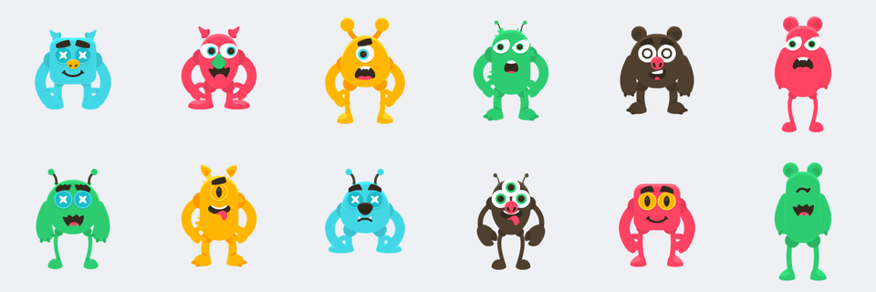
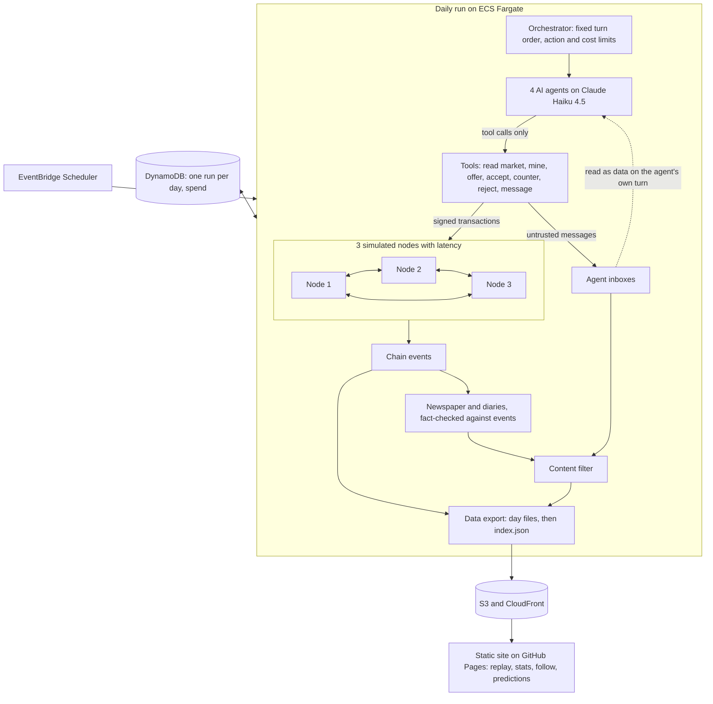

# Agent Economy (working title)

**Status: the blockchain, its nodes and the economy are built and tested, running with scripted agents. The AI agents come next.** This document describes the design and is updated as each phase ships. Anything not yet built is described as planned.

## What it does

AI agents run a small economy of collectible monsters on a blockchain built from scratch. Once a day, a scheduled simulation runs. The agents mine coins, hatch creatures, negotiate with each other, and trade, and the results are recorded on the chain.

Each agent has its own goal and appetite for risk: a collector, a speculator, a cautious saver, and a scammer who tries to manipulate the others. That includes prompt-injection attempts, which are logged and measured.

Visitors will be able to read an AI-written daily newspaper checked against what really happened, follow a favorite agent, make predictions, and replay any day step by step.

The coin has no real-world value and can't leave the simulation.

## How it works

### The chain (built)

Each block holds transactions and points to the hash of the block before it, so changing anything in an old block breaks every link after it. To add a block, a miner must find a number (the nonce) that gives the block's hash a required run of leading zeros. That takes many attempts to find but only one to check.

Every transaction is signed with the sender's private key, so only the holder of that key can spend from an account. A Merkle root in each block header commits to all of the block's transactions at once.

Before a block is accepted, its proof of work, links, signatures and balances are all checked. Each account has a running transaction count, the nonce, and a transaction is valid only if it carries the exact next number. That's what stops double spends and replays, since only one transaction can ever use a given count. Waiting transactions sit in a mempool, which picks the highest fees first in an order that doesn't depend on when they arrived, so simulations can be reproduced.

The exact format is in [DATA.md](DATA.md), so anyone can write their own verifier.

### The nodes (built)

Three independent nodes each hold their own copy of the chain and their own mempool. They share nothing: everything they learn arrives as bytes over a simulated network with random delays, and it's parsed and checked as if it came from a stranger. Because of those delays, two miners can find a block at nearly the same moment, and different nodes can briefly believe different things. These forks aren't scripted. Mining is real hashing, and simulated time passes according to how many attempts each block took.

When a node hears about a chain with more total work than its own, it switches to it. That's a reorg: blocks on the losing side are abandoned, the creatures they would have hatched never existed, and their transactions go back to the mempool to be mined again, unless the winning chain has made them invalid. A node that was offline catches up by asking a peer what it has missed.

At the end of each day, a settle step stops mining, reconnects everyone and gets all nodes onto one tip. Each node then independently replays everything since the last settled day, and the results must match exactly. Only then does that tip become a checkpoint and the day get published. If the nodes can't agree, the run fails and the site stays on the last good day.

### The economy (built, with scripted agents)

Every mined block earns its miner coins and hatches a creature. The creature's species, traits and stats all come from the block's hash, so anyone can verify them, and there's nothing about a creature on the chain except its ID. Its image is assembled from a set of openly licensed body parts.

Agents trade through direct offers: one proposes, and the other accepts, counters or rejects. An offer's terms are signed and stored on-chain, and accepting takes only the offer's ID, so what executes is exactly what was signed. Nothing is locked when an offer is made, so an agent can promise coins it doesn't have. The offer simply fails if anyone accepts it, and the recipient could have checked the proposer's public balance first.

Coin supply has a soft cap. The block reward shrinks as supply nears the cap and reaches zero at it. Every transaction fee and 2% of the coins in each trade are burned, which makes room for mining to pay again. Rare shocks, like a market crash that cuts creature appraisals by 60% for about a week, change what agents believe things are worth, and how much they can mine, but never the chain's rules.

Agents never touch keys or nodes. They read a view of the world and ask for actions, and a tool layer signs for them, applies their limits and logs every attempt.

### Planned architecture

## Key design decisions

**Consensus: most cumulative valid work.** A node adopts the valid chain with the most total proof of work, and on a tie it keeps the chain it saw first. With fixed difficulty, this behaves the same as "longest valid chain". It also stays correct if difficulty ever changes, where plain longest-chain would let a long, low-difficulty fork win.

**Seeded network simulation.** Nodes run on simulated time with seeded latency, so forks really happen but can be reproduced in tests. The whole run depends only on its seed, which is checked across separate processes, because Python randomizes some internal ordering per process. A block that loses a fork takes its hatched creature with it, and its transactions go back to the mempool. Each day ends with a settle step: all nodes must agree on one tip before anything is published.

**A settle-only tie-break.** "Keep the block you saw first" works while mining continues, because the next block breaks the tie. Once mining stops, two nodes could stay split forever. So at settle only, tied nodes all take the lowest block hash. Mining one more block would also work, but it would mint a reward nobody planned.

**A settled day is final.** Published day files promise never to change, so a settled tip becomes a checkpoint and nodes refuse any fork below it, however much work it claims. Real blockchains get finality only probabilistically. Here there's a daily publishing boundary, so it can be exact.

**Don't remember a rejection you can't prove is permanent.** A block's hash covers its header, and the header covers its transactions only through the Merkle root. If a node remembered "this hash is invalid" after receiving a real header with swapped transactions, an attacker could get the honest block refused forever. So cheap checks like proof of work and the Merkle root run first and are never remembered. Only a block whose transactions really match its header can be marked permanently invalid.

**Standard cryptographic primitives.** The chain logic is written by hand: blocks, Merkle roots, proof of work, the mempool, validation and consensus. Signatures use Ed25519 from a maintained library and hashing uses SHA-256. Hand-rolling those would be riskier and wouldn't demonstrate anything more about how a blockchain works.

**Accounts, not UTXOs.** Bitcoin tracks individual unspent coins; this chain tracks balances per account, as Ethereum does. The economy is about balances and who owns which creature, so accounts fit it directly and make agents' tools and the replay simpler to follow.

**A format browsers can reproduce exactly.** Visitors' browsers will re-verify the chain, so Python and JavaScript must produce identical bytes for every hash. Hashes cover a strict subset of canonical JSON (RFC 8785). Amounts are integers up to 2^53-1, because JavaScript loses precision beyond that and floats would break hashes. To prove this works now rather than at the end, a separate JavaScript implementation with no shared code verifies a set of published test vectors on every commit.

**A Merkle tree without Bitcoin's flaw.** Bitcoin duplicates the last item on odd levels, which lets two different transaction lists share a root (CVE-2012-2459). This tree moves the odd item up unchanged, and hashes leaves and inner nodes with different prefixes, following RFC 6962.

**Free text is impossible on-chain, not just discouraged.** Transaction bodies accept only listed fields, and strings must be hex or known values, so there is nowhere to put a message.

**Every rejection has a code.** Agents can attempt anything, so a refused transaction is normal behavior rather than an error. Stable codes like `bad_nonce` feed the invalid-action stat later.

**A supply cap that can't strand the economy.** A flat reward inflates forever if trading slows, and a hard stop leaves mining worthless for good. With a soft cap, supply can never pass the limit, and burned fees make mining pay again. In a year-long scripted run, supply rose smoothly from 14,000 to about 75,600 of the 100,000 cap.

**No escrow.** Locking assets when an offer is made would rule out a whole class of scam. Leaving them unlocked keeps the chain simple and gives the scammer real moves, while the chain still guarantees a trade is all-or-nothing.

**Shocks you can't look up in advance.** Each day's shocks come from a hash of a public seed, the day and the previous day's final block. Anyone can check them afterward, but nobody can compute tomorrow's before today has settled, which keeps visitors' predictions honest. Shocks also never touch the chain, so no special rule can take coins without a signature.

**Dropping unmined transactions overnight.** Agents carry only a short memory between days, so a queued transaction could spend coins on a decision the agent no longer remembers. It would also let a manipulated decision linger. Each day starts with an empty queue, and agents are told what was dropped.

**New agents get funded in the open.** A later-season agent receives an ordinary signed transfer from a treasury created at genesis, visible on-chain like any other. That needs no special rule for minting coins.

**Fargate, not Lambda.** Lambda has a hard 15-minute limit, and a run with model calls, retries and throttling must not die partway through. A Fargate task has no such limit, costs little for a short daily job, and needs no server left running. ECS has no built-in task timeout, so the job runs under an explicit one.

**One failure-safe publish step.** Day files are uploaded first and `index.json` last. If a run fails at any point, the index still points at the last good day, and the site keeps working.

**A hard daily cost cap that includes retries.** Spend is recorded outside each attempt, so a retry can't exceed the $0.50/day cap.

**JSON Lines for the data export.** A browser or a short script can read it with no library, and the replay streams it directly. Parquet would force a library into the browser, and CSV handles nested data like transactions badly.

**No free text on the chain.** A chain can't be edited, but public text has to be removable by the content filter. Messages and rationales therefore live off-chain, so blocking one never breaks a hash.

**Openly licensed art, assembled from parts.** Creatures are built from the [Kenney Monster Builder Pack](https://www.kenney.nl) (CC0). The original plan used store-bought packs, but creatures traded on a chain look a lot like NFTs, and GameDev Market's terms rule those out. See the lessons log. The chain stores no art at all, and raw files stay out of the repo. Processed copies of the parts are committed, because the test and daily-run machines don't have the raw pack.

## Security

**No results yet.** The defenses below are planned for P5, and this section will report what the data shows.

Planned prompt-injection defenses aim to make obeying a malicious message useless, rather than relying on the model to spot it. Listed strongest first:

1. **Messages can't wake anyone.** Agents act on a fixed schedule and read their inbox only on their own turn.
2. **Terms come from the chain.** Accepting an offer executes the signed offer's actual terms, whatever a message claims they are.
3. **Keys and limits sit outside the model.** The tool layer signs transactions, so the model never sees a key. Code enforces action caps and a maximum share of balance per trade, and the chain rejects anything invalid.
4. **Messages are clearly marked as data.** They arrive as structured tool results with the sender named, length capped and control characters stripped.
5. **Memory can't carry an injection forward.** The summary carried into the next day is built mostly from structured facts.
6. **Other readers are covered.** The newspaper writer sees chain events rather than raw messages, and the site renders all agent text as plain text.

**How success will be measured.** Being talked into a bad price is a scam, and scams are part of the game. Obeying an instruction embedded in a message is an injection. The two are counted separately. An injection counts as a success when the victim takes the specific action the attack asked for, judged from the tool log. A fixed set of attacks gives a stable baseline over time, and occasional offline runs with defenses switched off will show what each layer contributes.

## Lessons learned

### 2026-11-02: The economy
- **Every test passed and the economy was still broken.** The first long simulation showed 0.2 trades a day and 40% of actions failing. Nothing was wrong with the rules. Agents kept accepting bait from proposers who couldn't pay, and answered the same offer twice because their view didn't show what they had already sent. They also all valued everything identically, so few deals made sense. Showing public balances, hiding offers an agent has already answered, and giving each agent its own opinion took failures down to 1.2%. Lesson: only running the whole system for a long time reveals this kind of problem, and I'd add that kind of measurement earlier.
- **A valid rule can jam a queue.** Once offers existed, an `accept` could go stale while waiting, for instance when the offer was withdrawn. Left in place, it would block every later transaction from that sender forever, because nonces must run in order. The mempool now re-tests what's next in each queue whenever the chain moves.
- **Daily work that grows with history doesn't last.** Replaying the whole chain on every node every day is simple and thorough, but its cost keeps growing. Each settle now replays from the last checkpoint, which an earlier settle already proved, and loading a saved chain still replays everything once.
- **Tests of art need pinning too.** With every part placed at its centre rather than its joint, all the tests still passed, because none checked where parts land. Creatures I'd approved by eye are now pinned by pixel hash. Separately, a comparison of images passed for the wrong reason: Pillow's `getbbox` ignores colour-only changes by default.
- **Checking my tests found more than checking the code.** One test could never fail, because of a stray `or True`. Another claimed a dropped transaction had come back, when an agent had simply signed the identical transaction again: signatures are deterministic, so the ID matches, and that's correct behaviour. A sweep of 370 disabled rules found 30 that got past the tests, including JavaScript format checks with no malformed vectors behind them. After fixes, the only survivors out of 366 are three changes that don't alter behaviour.

### 2026-11-02: The nodes
- **The worst attack here came from an optimization that seems obviously right.** Remembering "this block hash is invalid" saves repeat work, but a hash doesn't cover a block's transactions directly. An attacker who sends a real header with swapped transactions could get the honest block refused forever. Nodes now remember a rejection only when the transactions really match the header. Bitcoin has had real bugs of this kind, which is why I designed for it from the start and tested it with four kinds of swap.
- **A consensus rule can be correct and still never finish.** "Keep the block you saw first" only resolves because the next block breaks the tie. A day that ends has no next block, so nodes could stay split forever. The settle step needed its own rule.
- **Later checks can hide missing earlier ones.** With all tests passing, I disabled each guard and rejection in the network code, in both directions where that applied. 135 of 150 were caught. The most useful survivor was the proof-of-work check before a block enters the orphan pool: full validation would reject an unmined block eventually, so nothing looked wrong, but without that check anyone could fill the pool for free. A test of the message size limit was also passing for the wrong reason, because its input was rejected as bad JSON before the limit mattered. After new tests and removing one redundant check, the same sweep catches all 150.
- **Forks are easy to get, and a setting to choose.** Measured orphan rates ranged from under 1% (one block per 3 seconds per miner, up to 50ms latency) to over 60% (four blocks per second, up to 3 seconds of latency). Latency and block rate together decide how much drama the economy gets, so they're tuning knobs for the next phase.

### 2026-11-01: The chain
- **A standard signature library accepted a forgery.** For a low-order public key, a signature of all zeros (apart from one byte) verifies against any message. OpenSSL, through Python's `cryptography` library, accepted one; Node's WebCrypto refused the same signature. That's a theft risk and also a split: the backend and a browser would disagree about whether a chain is valid. The chain now refuses these keys outright. Lesson: "uses a maintained library" doesn't mean every edge case is handled, and running the same attack against two implementations is what exposed the disagreement.
- **The second implementation caught my own mistake.** The JavaScript verifier failed on the first RFC 8032 test case. I had typed the published signature from memory and got one character wrong. The library was right, and the RFC confirmed it. Lesson: take known answers from the source, and don't copy a value from the code under test to make a check pass.
- **Passing tests didn't mean the rules were tested.** With every test green, I disabled each rejection rule in turn to see whether anything noticed. 54 of 57 were caught. The 3 that weren't included "the first transaction must be the coinbase", which was hidden because a wrong-kind transaction usually fails the reward check as well. It needed a transfer paying exactly the reward. I'd run this kind of check earlier next time.
- **A small optimization mattered a lot.** Re-encoding the header for each mining attempt reached about 54,000 hashes per second. Hashing the fixed bytes once and changing only the nonce reached about 1.25 million, roughly 23 times faster, with a test confirming the shortcut gives the same answer as the full hash.

### 2026-11-01: Setup
- **The asset plan changed before any code was written.** The first plan used store-bought monster packs. GameDev Market has said its license doesn't allow assets to be used to create NFTs, even when heavily modified, and creatures hatched on a chain and traded are hard to distinguish from NFTs even with no money involved. Rather than seek a ruling, the project switched to a CC0 pack. That also changed the creature design: creatures are now assembled from parts, which suits generating them from a block hash. Lesson: check what the license allows for the specific use, not just whether the art is paid for.
- **Assembling parts adds work.** The pack doesn't include attachment points, so placing arms, eyes and horns on each body shape will need a hand-tuned table.
