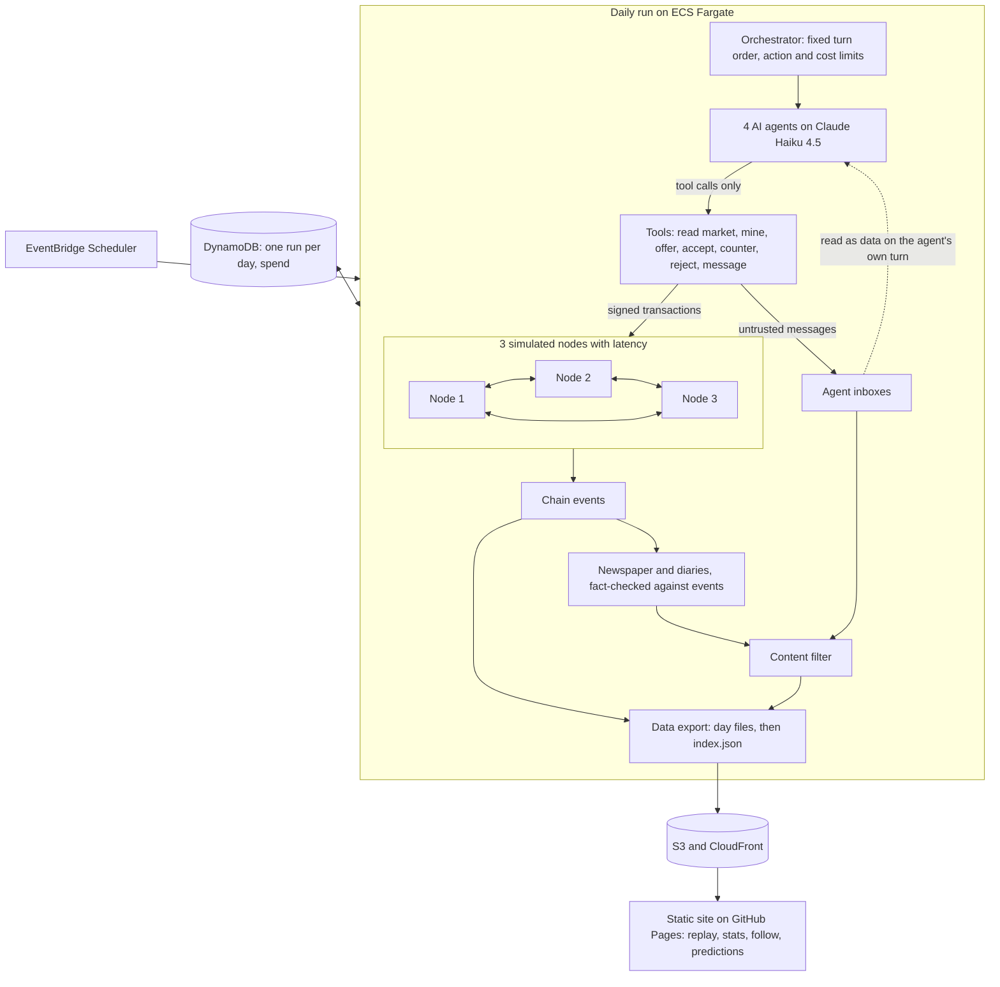

# Agent Economy (working title)

**Status: setup complete; the chain and simulation aren't built yet.** This document describes the design and is updated as each phase ships. Anything not yet built is described as planned.

## What it does

AI agents run a small economy of collectible monsters on a blockchain built from scratch. Once a day, a scheduled simulation runs. The agents mine coins, hatch creatures, negotiate with each other, and trade, and the results are recorded on the chain.

Each agent has its own goal and appetite for risk: a collector, a speculator, a cautious saver, and a scammer who tries to manipulate the others. That includes prompt-injection attempts, which are logged and measured.

Visitors will be able to read an AI-written daily newspaper checked against what really happened, follow a favorite agent, make predictions, and replay any day step by step.

The coin has no real-world value and can't leave the simulation.

## How it works

Planned architecture:

## Key design decisions

**Consensus: most cumulative valid work.** A node adopts the valid chain with the most total proof of work, and on a tie it keeps the chain it saw first. With fixed difficulty, this behaves the same as "longest valid chain". It also stays correct if difficulty ever changes, where plain longest-chain would let a long, low-difficulty fork win.

**Seeded network simulation.** Nodes run on simulated time with seeded latency, so forks really happen but can be reproduced in tests. A block that loses a fork takes its hatched creature with it, and its transactions go back to the mempool. Each day ends with a settle step: all nodes must agree on one tip before anything is published.

**Standard cryptographic primitives.** The chain logic is written by hand: blocks, Merkle roots, proof of work, the mempool, validation and consensus. Signatures use Ed25519 from a maintained library and hashing uses SHA-256. Hand-rolling those would be riskier and wouldn't demonstrate anything more about how a blockchain works.

**Fargate, not Lambda.** Lambda has a hard 15-minute limit, and a run with model calls, retries and throttling must not die partway through. A Fargate task has no such limit, costs little for a short daily job, and needs no server left running. ECS has no built-in task timeout, so the job runs under an explicit one.

**One failure-safe publish step.** Day files are uploaded first and `index.json` last. If a run fails at any point, the index still points at the last good day, and the site keeps working.

**A hard daily cost cap that includes retries.** Spend is recorded outside each attempt, so a retry can't exceed the $0.50/day cap.

**JSON Lines for the data export.** A browser or a short script can read it with no library, and the replay streams it directly. Parquet would force a library into the browser, and CSV handles nested data like transactions badly.

**No free text on the chain.** A chain can't be edited, but public text has to be removable by the content filter. Messages and rationales therefore live off-chain, so blocking one never breaks a hash.

**Openly licensed art, assembled from parts.** Creatures are built from the [Kenney Monster Builder Pack](https://www.kenney.nl) (CC0). The original plan used store-bought packs, but creatures traded on a chain look a lot like NFTs, and GameDev Market's terms rule those out. See the lessons log. The chain stores only part IDs, never art.

## Security

**No results yet.** The defenses below are planned for P5, and this section will report what the data shows.

Planned prompt-injection defenses aim to make obeying a malicious message useless, rather than relying on the model to spot it. Listed strongest first:

1. **Messages can't wake anyone.** Agents act on a fixed schedule and read their inbox only on their own turn.
2. **Terms come from the chain.** Accepting an offer executes the signed offer's actual terms, whatever a message claims they are.
3. **Keys and limits sit outside the model.** The tool layer signs transactions, so the model never sees a key. Code enforces action caps and a maximum share of balance per trade, and the chain rejects anything invalid.
4. **Messages are clearly marked as data.** They arrive as structured tool results with the sender named, length capped and control characters stripped.
5. **Memory can't carry an injection forward.** The summary carried into the next day is built mostly from structured facts.
6. **Other readers are covered.** The newspaper writer sees chain events rather than raw messages, and the site renders all agent text as plain text.

**How success will be measured.** Being talked into a bad price is a scam, and scams are part of the game. Obeying an instruction embedded in a message is an injection. The two are counted separately. An injection counts as a success when the victim takes the specific action the attack asked for, judged from the tool log. A fixed set of attacks gives a stable baseline over time, and occasional offline runs with defenses switched off will show what each layer contributes.

## Lessons learned

### 2026-11-01: Setup
- **The asset plan changed before any code was written.** The first plan used store-bought monster packs. GameDev Market has said its license doesn't allow assets to be used to create NFTs, even when heavily modified, and creatures hatched on a chain and traded are hard to distinguish from NFTs even with no money involved. Rather than seek a ruling, the project switched to a CC0 pack. That also changed the creature design: creatures are now assembled from parts, which suits generating them from a block hash. Lesson: check what the license allows for the specific use, not just whether the art is paid for.
- **Assembling parts adds work.** The pack doesn't include attachment points, so placing arms, eyes and horns on each body shape will need a hand-tuned table.
